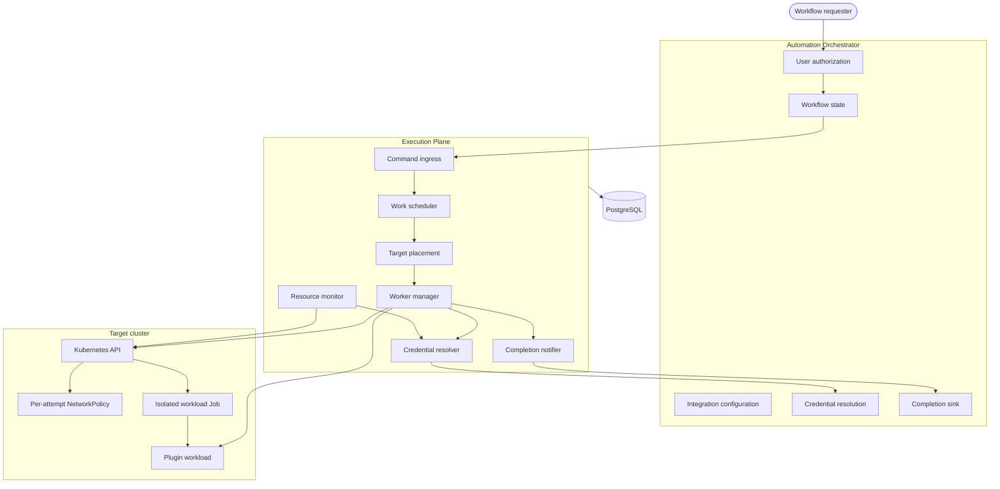
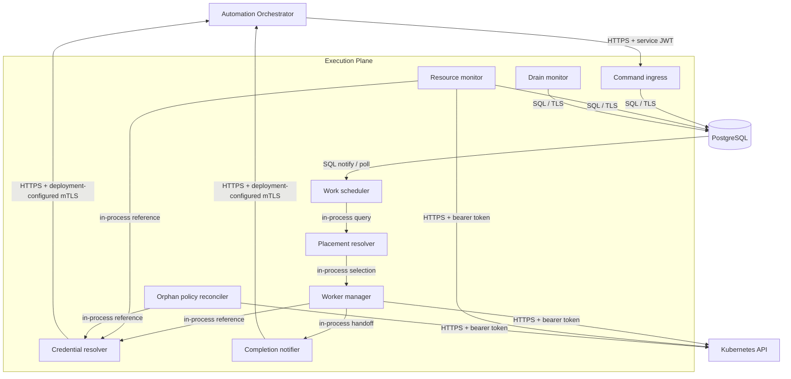
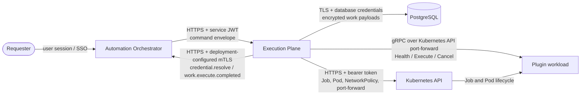
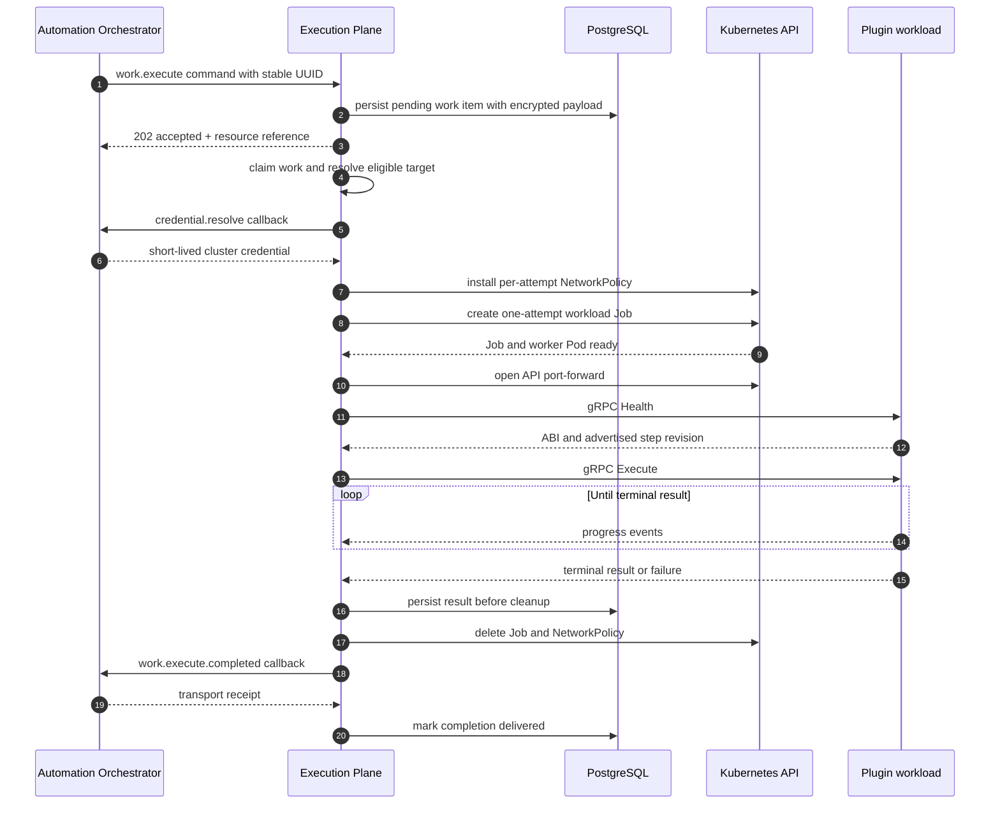
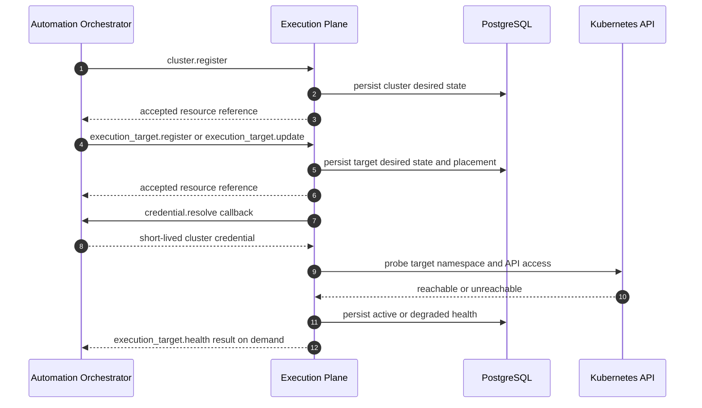
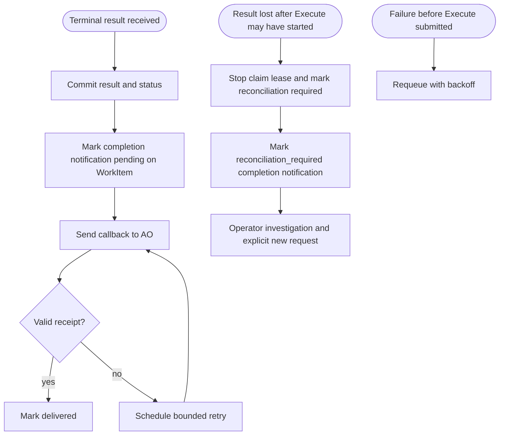
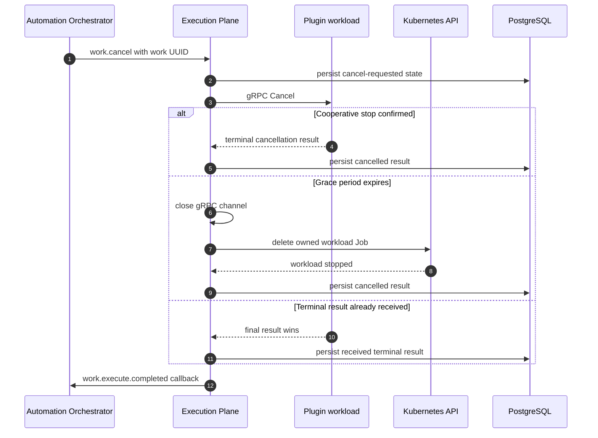
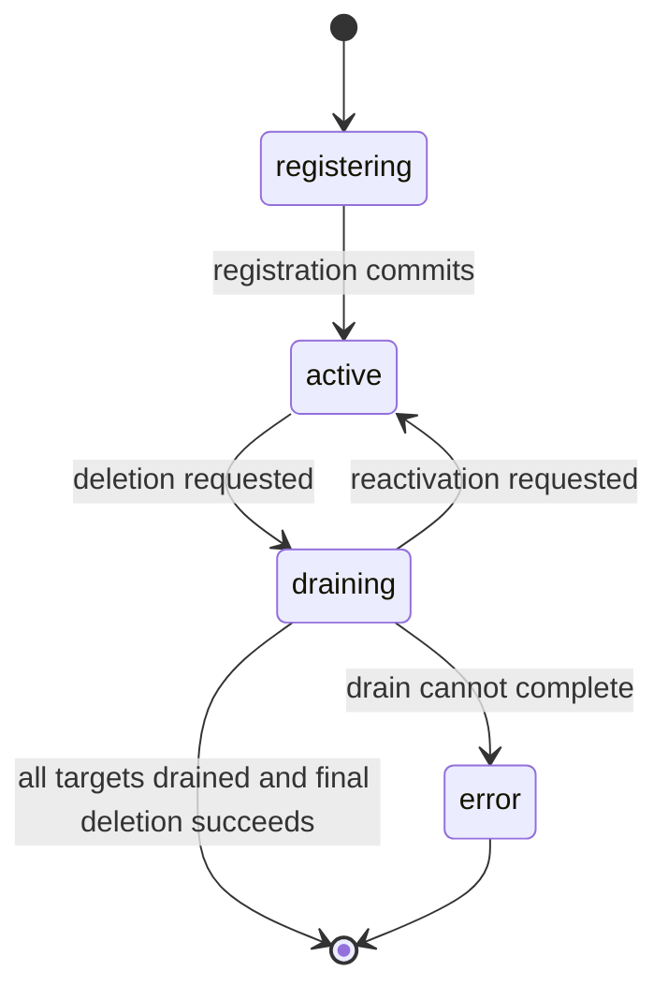
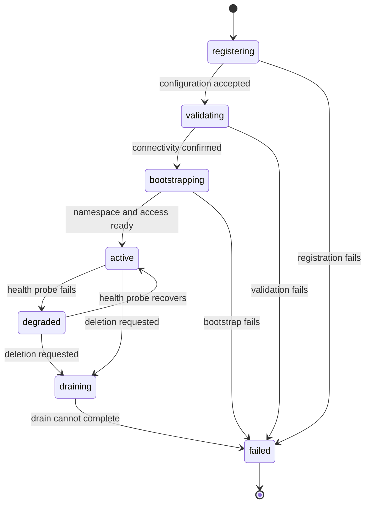
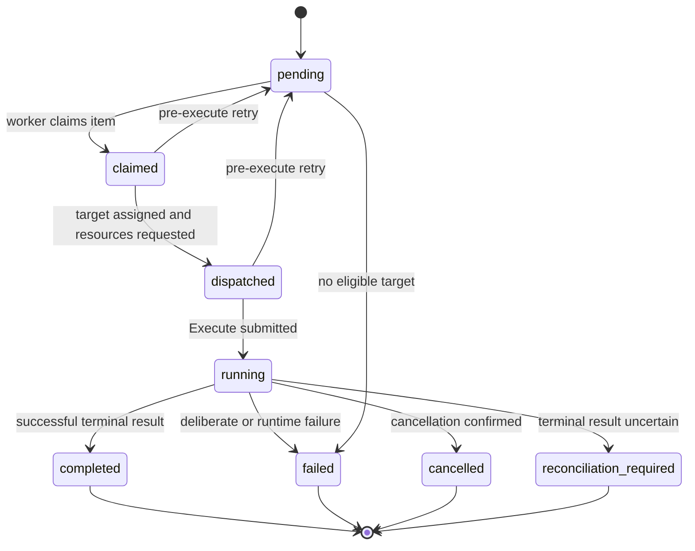

# Execution Plane architecture

This document describes the current Execution Plane architecture as a set of
logical responsibilities, protocols, and end-to-end flows. It is intentionally
implementation-neutral: component names refer to architectural roles rather than
source files or classes.

## Source initiatives

- [ANSTRAT-1803](https://redhat.atlassian.net/browse/ANSTRAT-1803) defines the Execution Plane as a scalable, secure execution tier for Automation Orchestrator workloads. It focuses on isolated container execution, independently managed targets, and safe control-plane-to-execution-plane communication.
- [ANSTRAT-2422](https://redhat.atlassian.net/browse/ANSTRAT-2422) defines the Plugin SDK and the shared contracts used by workflow step authors. It establishes versioned step definitions, manifest rules, execution placement boundaries, and the gRPC contract consumed by the Execution Plane.
- [ANSTRAT-2523](https://redhat.atlassian.net/browse/ANSTRAT-2523) containerizes existing workflow step types so they can run through the Execution Plane using the Plugin SDK contracts. It preserves existing workflow semantics while moving step execution into isolated, versioned containers.

## Current scope

- The Automation Orchestrator (AO) is the only configured caller.
- The Execution Plane (EP) executes container workloads on Kubernetes.
- OpenShell is represented as a future backend, but the current dispatch path is
  Kubernetes-only.
- Workload credentials are not injected as files in the current release.

## System context

## Execution Plane component topology

## Responsibility boundaries

| Participant | Owns |
| --- | --- |
| AO | User authorization, workflow orchestration, user-facing workflow state, integration configuration, credential resolution, and the command that requests work. |
| EP | Durable work state, target and cluster bindings, placement decisions, execution attempts, result persistence, completion delivery, and execution diagnostics. |
| PostgreSQL | Durable state for work, targets, clusters, attempts, and inline completion-delivery state on work items. |
| Kubernetes | Workload scheduling, pod lifecycle, namespace isolation, network policy enforcement, and API-mediated access to the workload. |
| Plugin workload | The workload ABI, execution semantics, progress and result events, and cooperative cancellation. |
| Plugin SDK | The versioned gRPC contract and generated bindings shared by EP and workload images. |

## Protocol and trust boundaries

Application-layer identity on AO-to-EP ingress is the service JWT. mTLS is a
transport-hardening layer that deployments may enable on top of that contract;
the deployment manifests used by this repository and the AO operator provide
the certificate material for it.

### Command families

| Direction | Command family | Purpose |
| --- | --- | --- |
| AO → EP | `work.execute` | Submit one container workload with a stable UUID. |
| AO → EP | `work.cancel` | Request cooperative cancellation of an existing work item. |
| AO → EP | `cluster.*` | Register, update, or drain a Cluster. |
| AO → EP | `execution_target.*` | Register, update, delete, or health-check an execution target. |
| EP → AO | `credential.resolve` | Resolve an opaque cluster or target credential reference. |
| EP → AO | `work.execute.completed` | Deliver a terminal or uncertain outcome from EP to AO. |

## End-to-end work execution

## Target registration and health

## Completion and uncertain outcomes

## Cancellation

## Cluster lifecycle

## Execution target lifecycle

## Work item lifecycle

## Security control inventory

| Boundary | Controls |
| --- | --- |
| AO → EP ingress | HTTPS, ES256 service JWT, issuer and audience validation, client allow-list, command-scope enforcement, strict JSON parsing, body and payload size limits. A deployment may also require or present a client certificate, but the service JWT remains the mandatory application-layer identity. |
| EP → AO callbacks | HTTPS with deployment-configured mTLS, typed command envelopes, receipt correlation, bounded retries. |
| EP → PostgreSQL | TLS with configurable verification and optional client certificates, service-owned database credentials, AES-GCM encryption of work payloads. |
| EP → Kubernetes | TLS with optional custom CA, bearer token from a short-lived resolved credential, no credential persistence, sanitized API errors. |
| Workload isolation | No service-account token in the workload Pod, non-root execution, read-only root filesystem, dropped Linux capabilities, RuntimeDefault seccomp, bounded CPU and memory, memory-backed temporary storage, one completion, no Job backoff, active deadline, TTL cleanup backstop. |
| Workload network | Per-attempt NetworkPolicy, ingress denied, DNS permitted, operator-configured egress allow and deny ranges. |
| Workload ABI | Pinned plugin SDK contract, Health/Execute/Cancel semantics, one invocation per execution attempt, progress and terminal events on a bounded gRPC stream. |
| Result safety | Result committed before resource cleanup, claim-owner and claim-generation fencing, no automatic rerun after Execute may have started. |
| Completion delivery | Durable WorkItems-table state, at-least-once delivery, exponential backoff with jitter, receipt validation. |
| Credential handling | Opaque references only in durable state, short-lived resolution through AO, no raw credential logging or API exposure. |
| Logging and diagnostics | Structured logs, bounded Kubernetes response bodies, sanitized work-item errors, no raw credentials or private payloads in results. |
| Image provenance | Image reference is caller-supplied; EP does not independently enforce registry policy or digest pinning. |

## Current limitations

- Only AO is a configured caller.
- Only the Kubernetes backend is registered for execution.
- Only container workloads are dispatched; other workload types are future work.
- Workload credential-file injection is not implemented.
- EP does not enforce image provenance beyond accepting the caller-selected image reference.
- EP-to-workload control traffic is tunneled through the Kubernetes API rather than exposed as direct pod networking.
- A lost terminal result after Execute may have started is marked for reconciliation rather than automatically retried.
- OpenShell is modelled as a backend type but is not part of the current execution path.
