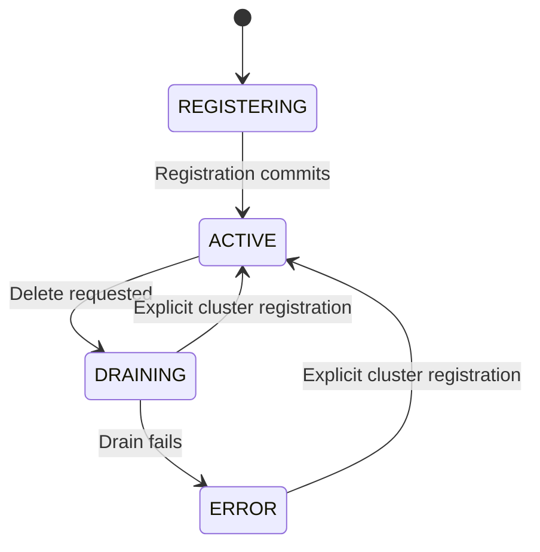
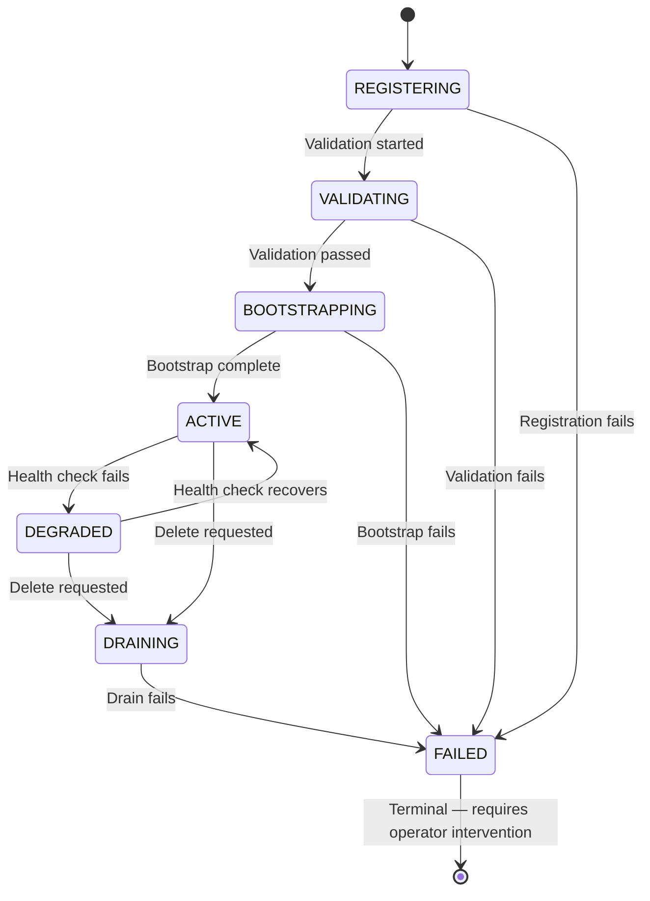
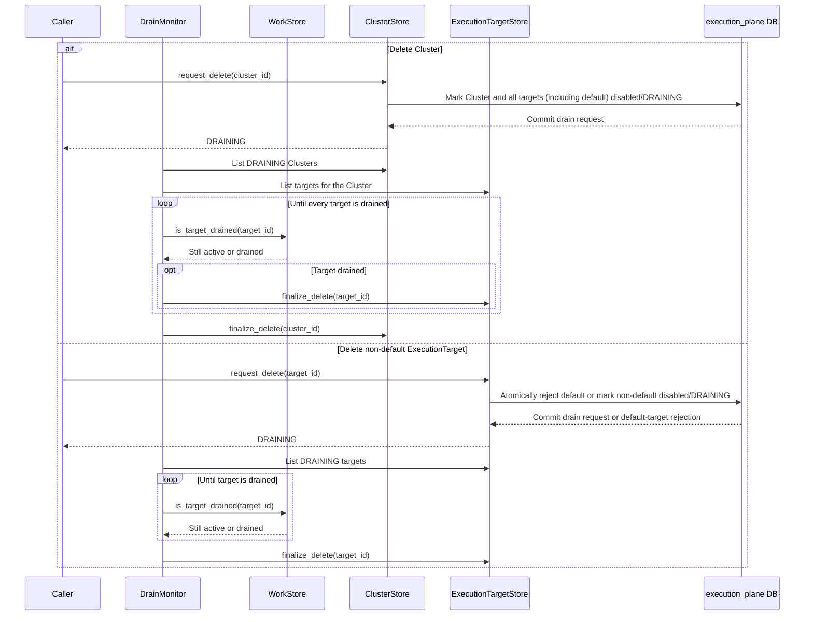
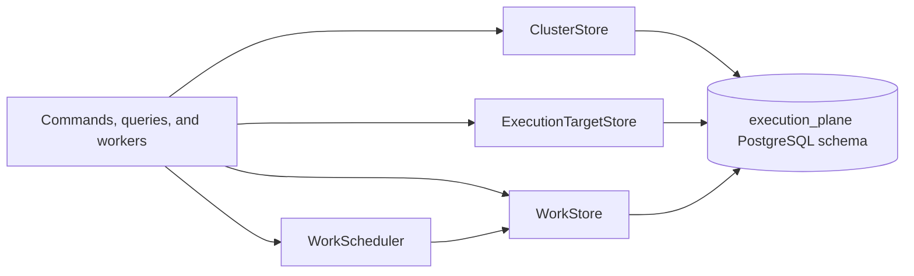

# Execution Plane: Cluster and Execution Target Architecture

## Status and scope

This document defines the architectural model for Clusters and
ExecutionTargets in the Execution Plane. It describes the entities,
relationships, invariants, security boundary, persistence boundary, and
lifecycle operations. It is independent of a particular API, database
migration sequence, or external infrastructure provider.

The terminology follows AAP-92716 while using **Cluster** and
**ExecutionTarget** as the domain names. A Cluster is a logical compute
environment, such as an OpenShift installation, a RHEL machine pool, or
another supported environment. An ExecutionTarget is a concrete endpoint at
which work can be executed.

## Architectural principles

- A registered Cluster may own zero or more ExecutionTargets. Target registration
  is a separate command, with an explicit ownership relationship in the database.
- Registering a Cluster does not create a default target. Target commands manage
  target creation and default selection.
- Eligibility and lifecycle are separate concerns. `enabled` controls whether
  a resource may participate in selection; lifecycle status records its
  operational state.
- Consumers depend directly on concrete model stores. Stores own database
  sessions, transactions, and persistence details; orchestration stays in
  command handlers and `WorkScheduler`.
- Deletion is a lifecycle transition followed by asynchronous drain and
  physical finalization. It is not an immediate cascade delete.
- Connectivity secrets are protected credentials, not ordinary metadata.
- Every execution-plane database model carries the same audit contract.

## Entities and relationships

### Cluster

`Cluster` is a table in the `execution_plane` schema.

| Field | Semantics |
|---|---|
| `id` | UUID primary key |
| `name` | Required, human-readable name |
| `endpoint` | Cluster control-plane endpoint |
| `status` | `REGISTERING`, `ACTIVE`, `DRAINING`, or `ERROR` |
| `enabled` | Whether the Cluster may participate in selection or reconciliation |
| `is_default` | Whether this is the protected global default Cluster |
| `status_message` | Optional human-readable lifecycle or error detail |
| `labels` | JSONB administration and routing metadata; never secret credentials |
| `credential_ref` | Required AO UUID identifying the Cluster management credential |
| `created_by` | Actor or service identity that created the row |
| `created_at` | Creation timestamp |
| `updated_by` | Actor or service identity that last changed the row |
| `updated_at` | Last metadata or lifecycle update timestamp |

The Cluster `endpoint` identifies the control-plane endpoint.
`credential_ref` is opaque to EP. EP never persists, logs, or returns the raw
credential value. Before dispatch, health probing, or Kubernetes reconciliation,
EP sends a `credential.resolve` command to
`EP_CREDENTIAL_RESOLUTION_CALLBACK_URL` at the caller's command ingress and uses the correlated
credential value only in memory.

`REGISTERING` is the transient state used while constructing a new Cluster
inside its registration transaction. Successful registration commits the Cluster
as `ACTIVE`, even when it has no targets. `enabled` independently controls
eligibility. `DRAINING` prevents new work and indicates graceful removal;
`ERROR` records a failed drain. Re-registering a Cluster restores its `ACTIVE`
state and desired configuration without reactivating its targets.

#### Cluster lifecycle states



### ExecutionTarget

`ExecutionTarget` is a table in the `execution_plane` schema and belongs to
exactly one Cluster.

| Field | Semantics |
|---|---|
| `id` | UUID primary key |
| `cluster_id` | Non-null foreign key to `execution_plane.clusters.id` |
| `name` | User-facing target name |
| `backend_type` | Supported execution backend, such as `kubernetes` or `openshell` |
| `endpoint` | Target endpoint metadata; Kubernetes dispatch uses the Cluster endpoint |
| `credential_ref` | Required AO UUID identifying the target credential; Kubernetes dispatch uses the Cluster credential |
| `status` | `REGISTERING`, `VALIDATING`, `BOOTSTRAPPING`, `ACTIVE`, `DEGRADED`, `DRAINING`, or `FAILED` |
| `enabled` | Eligibility/configuration gate |
| `is_default` | Whether this is the Cluster's protected default target |
| `status_message` | Optional human-readable lifecycle or error detail |
| `labels` | JSONB target metadata and routing labels; never secret credentials |
| `created_by` | Actor or service identity that created the row |
| `created_at` | Creation timestamp |
| `updated_by` | Actor or service identity that last changed the row |
| `updated_at` | Last metadata or lifecycle update timestamp |
| `last_ran_at` | Last time work ran on the target |

`backend_type` identifies the execution backend used by the target. Supported
backends include a vanilla Kubernetes API and an OpenShell gateway. In this
document, an execution backend or backend provider is the external system that
hosts work.

The target `credential_ref` follows the same protection rules as the Cluster
reference. Kubernetes dispatch connects using `Cluster.endpoint`,
`Cluster.ca_certificate`, and the credential resolved from
`Cluster.credential_ref`. The target's `placement` supplies the namespace, node
selectors, and tolerations. Target `endpoint` and `credential_ref` are not used
for Kubernetes connectivity.

#### ExecutionTarget lifecycle states



The relationship allows a Cluster with no targets:

```text
Cluster 1 ──────── 0..* ExecutionTarget
```

An `ACTIVE` Cluster need not have an ExecutionTarget. Callers register targets
explicitly, supplying backend, placement, and default-selection requirements.

`WorkItem.execution_target_id` references the target selected for a claimed
work item. Administrative reads include draining records, while selection
queries require `enabled=True`, an `ACTIVE` status, and an `ACTIVE` Cluster.
Whether `DEGRADED` is eligible is a reconciler policy; it is not eligible by
default.

### WorkItem and audit contract

`WorkItem` is the durable unit of work exchanged between Execution Plane Consumers (such as a Temporal worker) and the Execution Plane worker. Its lifecycle timestamps,
including `claimed_at`, `completed_at`, and `signaled_at`, describe work
processing and are distinct from audit timestamps.

Every execution-plane database model, including `WorkItem`, `Cluster`,
`ExecutionTarget`, and future persistence models, contains:

- `created_by`
- `created_at`
- `updated_by`
- `updated_at`

Create operations populate the creator fields. Lifecycle transitions and
worker-owned changes update `updated_by` and `updated_at`. System-initiated
actions, such as claiming a WorkItem, use a well-known `SYSTEM` UUID as the
`updated_by` value rather than an ambiguous null actor.

## Invariants

The database and stores enforce the following invariants:

1. Exactly one Cluster has `is_default=True`.
2. A partial unique index on `execution_plane.clusters.is_default` where the
   value is true enforces uniqueness of the global default.
3. Promoting a Cluster atomically demotes the previous global default.
4. The current global default cannot be explicitly demoted or deleted; promote a
   replacement first.
5. Every ExecutionTarget has a non-null `cluster_id` referencing an existing
   Cluster.
6. An `ACTIVE` Cluster may have zero ExecutionTargets.
7. At most one target per Cluster has `is_default=True`.
8. A partial unique index on `execution_targets.cluster_id` where `is_default`
   is true enforces uniqueness of the default target.
9. The current default target can have its metadata updated, but it cannot be
   explicitly demoted or directly deleted. It can be deleted only after another
   target is promoted, or as part of a Cluster deletion.
10. A normal target update cannot change `cluster_id`. Setting `is_default=true`
   atomically promotes that target and demotes the Cluster's previous default.
11. A target is eligible for new work only when it and its Cluster are enabled
   and their lifecycle states permit selection.
12. A draining target cannot receive new work and cannot be physically deleted
   until its active work has completed.
13. A Cluster cannot be physically deleted while related targets remain.

## Independent cluster and target registration

`cluster.register` creates or updates only the caller-owned Cluster. The command
handler uses one transaction-backed `ClusterStore` for ownership checks,
configuration updates, activation, and Cluster default selection. The advisory
locks remain held until the changes commit. A failed registration rolls back the
whole operation and does not leave a partially registered Cluster.

Registration succeeds with zero targets. Registering, updating, or reactivating a
Cluster never creates, updates, or activates ExecutionTargets. Deletion still
coordinates draining of existing children before removing the parent.

Callers that need an execution destination submit `execution_target.register`
after registering the Cluster. They supply the target's placement (including the
Kubernetes namespace) and choose whether to promote it to default. Subsequent
changes use target commands. CI and local setup tools follow this same two-step
flow and reuse the existing target on repeated setup runs.

## Deletion and draining operation

Deletion has two distinct phases: a transactional drain request and later
physical finalization.

### Cluster deletion

`ClusterStore.request_delete(cluster_id)` performs one transaction that:

1. Loads the Cluster and verifies its existence.
2. Rejects deletion of the current global default Cluster.
3. Handles repeated requests according to the API's idempotency convention.
4. Sets the Cluster to `enabled=False` and `status=DRAINING`.
5. Sets every associated target, including the default target, to
   `enabled=False` and `status=DRAINING`.
5. Updates audit fields and commits.

The request returns the Cluster in its draining state. It does not launch a
drain task, wait for workers, or physically delete database rows.

The following sequence shows both the Cluster-wide and individual target
lifecycles. In either case, disabling the target closes the selection path
before `DrainMonitor` waits for active work to finish.



`DrainMonitor` owns drain polling in the worker process. It finds draining
Clusters through `ClusterStore`, relies on target eligibility filtering to
prevent new work, and asks the Work-owned `WorkStore` whether each target's active
workers and associated work have completed naturally. For each drained target
it calls `ExecutionTargetStore.finalize_delete`. A Cluster is deleted through
`ClusterStore.finalize_delete` only after all related targets have been
removed.

Drain polling runs as asyncio tasks initiated and supervised by `DrainMonitor`.
For a Cluster deletion, one task coordinates all of that Cluster's targets; for
an individual target deletion, a single task is launched. `DrainMonitor.start`
performs a recovery scan for persisted `DRAINING` Clusters and ExecutionTargets,
and its monitor loop continues observing newly requested drains.

If a drain operation fails irrecoverably, the affected Cluster or
ExecutionTarget transitions to `ERROR`. `ERROR` is a terminal state requiring
operator intervention to resolve.

### ExecutionTarget deletion

`ExecutionTargetStore.request_delete(target_id)` performs the target request:

1. It delegates to the Store transition, which atomically rejects direct
   deletion of the protected default target. The default target is removed only
   as part of a Cluster deletion.
2. For a non-default target, the Store marks it `enabled=False` and
   `status=DRAINING` in a transaction.
3. It updates audit fields and returns or exposes the draining state.
4. It returns without launching a drain task.
5. `DrainMonitor` observes the draining target and asks `WorkStore`
   whether its active workers and associated work have completed naturally.
6. After the drained predicate is satisfied, `DrainMonitor` delegates physical
   deletion to `ExecutionTargetStore.finalize_delete`.

The drained predicate is a worker/lifecycle concern and must account for the
WorkItem states and worker ownership semantics. Until the predicate is true,
the target remains in the database as an administrative record but is excluded
from selection.

## Persistence and domain boundaries

Consumers depend directly on `ClusterStore`, `ExecutionTargetStore`, and
`WorkStore`. Each store provides one concrete persistence API for its primary
model, without consumer-specific protocol classes or forwarding services.
`WorkStore` also owns completion-outbox operations.

`ClusterRegisterCommandHandler` coordinates Cluster registration in a caller-owned
transaction. Target handlers manage targets. `WorkScheduler` coordinates claim and placement.
Commands, queries, worker managers, drain monitoring, and reconciliation use
the concrete stores for persistence operations. Stores own sessions and
transactions.



### Stores

`ClusterStore` and `ExecutionTargetStore` follow the same persistence pattern as
`WorkStore`:
they borrow application-owned engines and open short-lived sessions, or borrow
a caller-owned transaction. A store bound with `from_transaction()` flushes
changes and leaves commit and rollback to its caller. Stores expose domain
operations and support asynchronous disposal/context-manager usage when owning
an engine.

`ClusterStore` provides creation of the `REGISTERING` record, retrieval,
listing, Cluster status transitions, Cluster drain requests, and finalization
guarded by the no-children invariant. Its cluster drain transaction also marks
the cluster's target rows draining so the parent and children cannot observe
inconsistent states. Cluster registration does not create ExecutionTargets.

`ExecutionTargetStore` provides target creation, retrieval, listing with
optional eligibility filtering, narrow metadata updates, drain requests, and
physical finalization. Its `finalize_delete` transition rechecks active WorkItems
and detaches historical work in the same transaction; it is callable only after
the worker's drain monitor has established that the target is safe to remove.

### Domain orchestration

`ClusterRegisterCommandHandler` owns the registration transaction.
`WorkScheduler` owns claim-and-place orchestration. Other consumers use the
concrete stores directly.

Administrative reads preserve lifecycle state while selection-oriented reads
exclude unavailable resources. `DrainMonitor` proves that a target is drained
before calling `ExecutionTargetStore.finalize_delete`. Workers, managers,
and the Completion Notifier share `WorkStore` for progress and outbox updates.

## API and security boundary

The API distinguishes a delete request accepted into `DRAINING` from later
physical deletion. Administrative list responses include lifecycle state and
relationship identifiers, including draining resources. Selection-oriented
queries provide an explicit eligible-only view.

Connectivity endpoints may be returned to authorized callers. Raw `api_key`
values are never returned. APIs expose only a redacted status or equivalent
non-secret metadata. Credentials must also be excluded from logs, labels,
ordinary model serialization, and audit payloads.

## Schema and operational considerations

The `execution_plane` schema contains the Cluster, ExecutionTarget, and
WorkItem tables. The schema must provide:

- a foreign key from `execution_targets.cluster_id` to `clusters.id`;
- a partial unique index for the global default Cluster;
- a partial unique index for one default target per Cluster;
- indexes for Cluster names, Cluster endpoints, target membership, lifecycle
  status, enabled state, and eligible-target queries;
- audit columns on every database model;
- required UUID `credential_ref` values for target and Cluster credentials.

The design does not prescribe whether the drained predicate is based solely on
terminal WorkItems, claimed workers, or an additional worker heartbeat. That
predicate is part of the worker lifecycle contract, but it must be strong
enough to ensure that finalization cannot race with active execution.

## Related context

- [AAP-92716](https://redhat.atlassian.net/browse/AAP-92716) describes the
  broader service concept and lifecycle concerns.
- [`integration.md`](integration.md) documents the service boundary
  crossings between Syntara and the Execution Plane.
